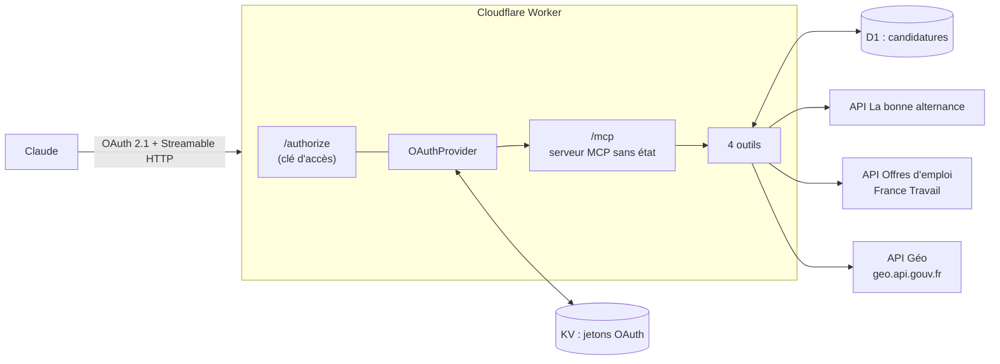

# mcp-alternance

Serveur [MCP](https://modelcontextprotocol.io) personnel qui permet à Claude de **chercher, lire, évaluer et suivre** des offres d'alternance et de stage en data et R&D, à partir de deux sources publiques et gratuites : **La bonne alternance** et **France Travail**.

Hébergé sur **Cloudflare Workers** (offre gratuite), protégé par une **clé d'accès personnelle**, avec un suivi des candidatures stocké dans **Cloudflare D1**.

> Projet de portfolio de [Deo Gratias Loutou](https://deogratias-loutou.fr), étudiant en M1 informatique à l'Université de Haute-Alsace (Mulhouse).

## Ce que fait le serveur

| Outil | Rôle |
| --- | --- |
| `chercher_offres` | Alternance ou stage · métier (`data_analyst`, `data_scientist`, `data_large`, `r_et_d`) · ville et rayon · date de début. Fusionne les deux sources, retire les doublons, trie par distance. |
| `lire_offre` | Annonce complète et lien pour postuler. |
| `evaluer_offre` | Compare l'offre à mon profil (compétences du CV, projets, disponibilité, niveau, distance) : ce qui colle, ce qui manque, ce qui est à vérifier. |
| `suivre_candidatures` | Ajoute, liste et met à jour mes candidatures (date, état, relance à 10 jours par défaut). |

Exemples de demandes à Claude une fois le connecteur ajouté :

- « Cherche des alternances de data analyst autour de Mulhouse qui commencent à partir de septembre 2027. »
- « Évalue l'offre lba:… et dis-moi quels projets mettre en avant. »
- « Ajoute cette offre à mes candidatures, je l'ai envoyée aujourd'hui. »
- « Quelles candidatures dois-je relancer ? »

## Architecture



```
src/
├── index.ts                  point d'entrée : OAuthProvider + serveur MCP
├── env.ts                    liaisons et secrets du Worker
├── auth/                     page /authorize, vérification de la clé en temps constant
├── mcp/serveur.ts            déclaration des 4 outils (schémas zod)
├── outils/                   logique des outils, testable sans réseau
├── sources/                  clients des API (La bonne alternance, France Travail, Géo)
├── domaine/                  modèle d'offre commun, métiers, profil, évaluation
└── candidatures/depot.ts     accès à la table D1
migrations/                   schéma SQL des candidatures
test/                         57 tests (Vitest)
docs/GUIDE.md                 installation pas à pas
```

## Choix techniques

- **Cloudflare Workers plutôt que l'hébergement OVH (PHP, sans base)** : Claude se connecte à un serveur distant en OAuth 2.1 avec enregistrement dynamique des clients. Cloudflare fournit pour cela une bibliothèque maintenue ([`@cloudflare/workers-oauth-provider`](https://github.com/cloudflare/workers-oauth-provider)), un stockage clé-valeur pour les jetons et une vraie base SQL (D1) gratuite. En PHP sans base, il aurait fallu réécrire le serveur OAuth et stocker les candidatures dans des fichiers JSON.
- **OAuth + clé d'accès** : sur claude.ai, un connecteur personnalisé s'authentifie en OAuth (l'envoi d'une clé fixe dans un en-tête est en bêta, réservé à certaines organisations). Le serveur joue donc lui-même le rôle de serveur OAuth, et sa page d'autorisation demande la clé d'accès. Sans secret `CLE_ACCES` d'au moins 32 caractères, personne ne peut se connecter.
- **Serveur MCP sans état** : une instance par requête avec le transport Streamable HTTP du SDK officiel (`WebStandardStreamableHTTPServerTransport`). Pas de Durable Object, rien à gérer entre deux appels.
- **Aucune donnée inventée** : chaque champ vient tel quel de la source ; une information absente reste `null` et s'affiche comme « non indiqué ». France Travail ne publie pas de date de début : le filtre par date garde ces offres en le signalant.
- **Évaluation explicable** : `evaluer_offre` repère des mots-clés et compare des dates. Pas de note sur 100 : chaque conclusion cite ce qui a été repéré dans l'annonce.
- **Dépendances injectées** : les outils reçoivent `fetch`, la base et la date du jour, ce qui permet de les tester sans réseau, avec une vraie base SQLite en mémoire (`node:sqlite`).

## Installer et déployer

Le guide complet, pas à pas (France Travail, La bonne alternance, Cloudflare, Claude, sous-domaine OVH) : **[docs/GUIDE.md](docs/GUIDE.md)**.

En résumé :

```bash
npm install
npx wrangler login
npx wrangler kv namespace create OAUTH_KV      # puis reporter l'id dans wrangler.jsonc
npx wrangler d1 create mcp-alternance          # puis reporter l'id dans wrangler.jsonc
npm run db:migrer
npx wrangler secret put CLE_ACCES              # et LBA_API_KEY, FT_CLIENT_ID, FT_CLIENT_SECRET
npm run deploy
```

Puis, dans Claude : connecteur personnalisé → URL `https://<votre-worker>/mcp` → saisir la clé d'accès sur la page qui s'ouvre.

## Développer

```bash
cp .dev.vars.example .dev.vars   # secrets locaux, jamais versionnés
npm run db:migrer:local
npm run dev                      # http://localhost:8787
npm test                         # tests unitaires et de bout en bout
npm run verifier                 # types + tests + construction du Worker
```

Pour tester les outils à la main : `npx @modelcontextprotocol/inspector`, puis l'URL `http://localhost:8787/mcp`.

## Adapter à son profil

- `src/domaine/profil.ts` : compétences, projets, langues et fenêtres de disponibilité (reprises de mon CV).
- `src/domaine/metiers.ts` : métiers et codes ROME (M1419 data analyst, M1405 data scientist ; `data_large` ajoute M1403 et M1805, filtrés sur la donnée).
- `src/outils/suivreCandidatures.ts` : délai de relance (`JOURS_AVANT_RELANCE`).

## Limites connues

- Depuis octobre 2026, l'API Offres d'emploi de France Travail est accordée sur demande ([fiche data.gouv.fr](https://www.data.gouv.fr/dataservices/api-offres-demploi)). Sans elle, le serveur fonctionne avec La bonne alternance seule, qui reprend déjà les offres d'alternance de France Travail.
- La bonne alternance ne couvre que l'alternance : les stages viennent uniquement de France Travail.
- La R&D n'a pas de code ROME : la recherche filtre sur le texte de l'annonce (« R&D », « recherche et développement »).
- Chaque source renvoie au plus 150 offres par recherche.
- L'API La bonne alternance est réservée aux usages non commerciaux.

## Licence

MIT. Les données restent la propriété de leurs producteurs (La bonne alternance, France Travail) et sont soumises à leurs conditions d'utilisation.
